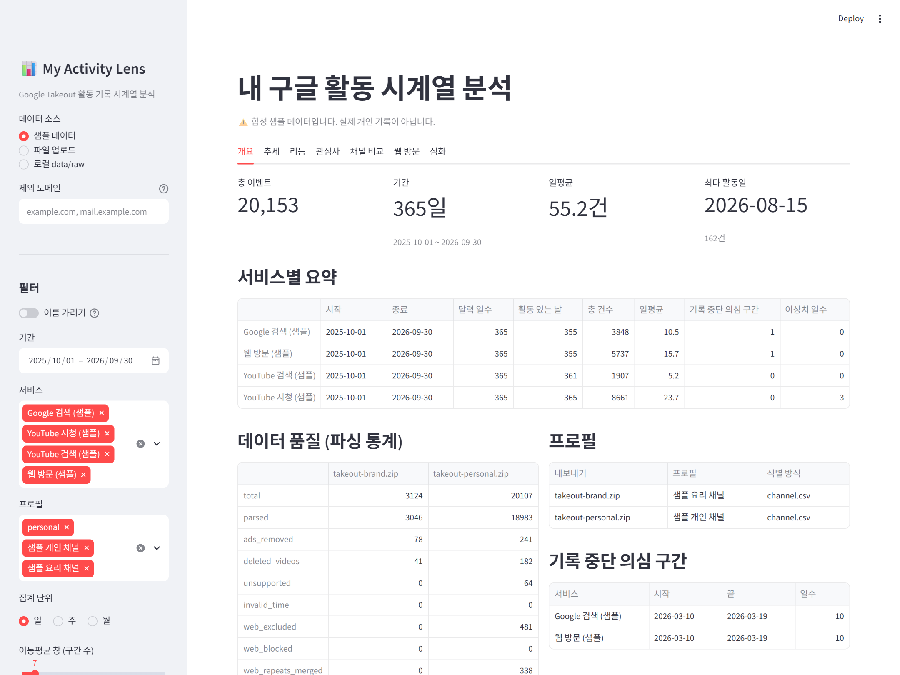
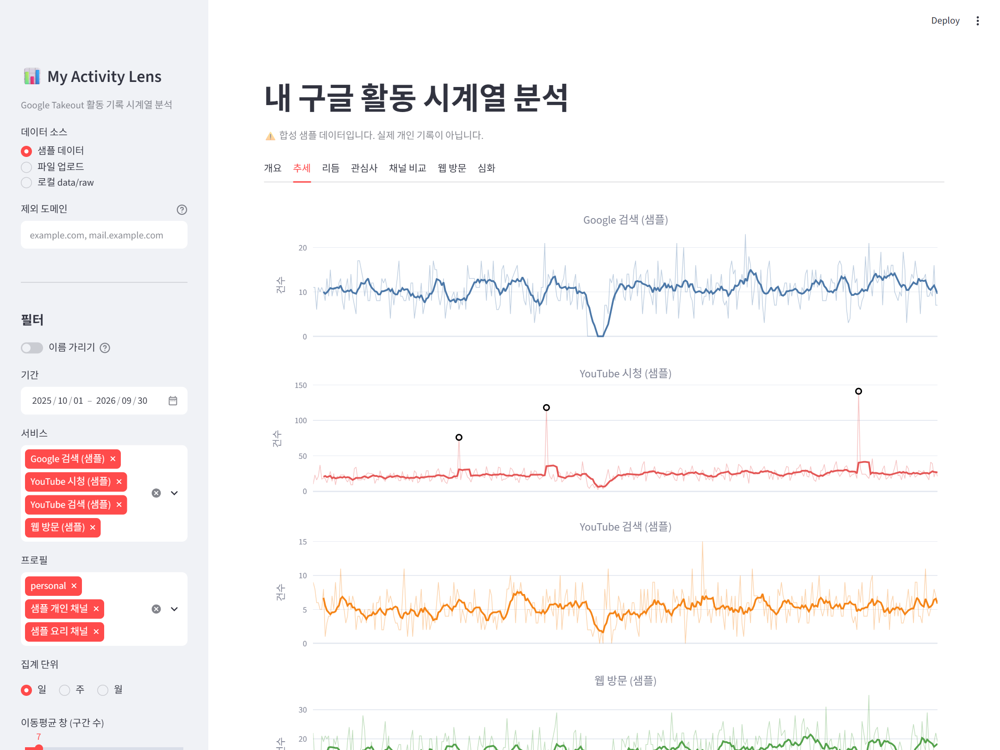
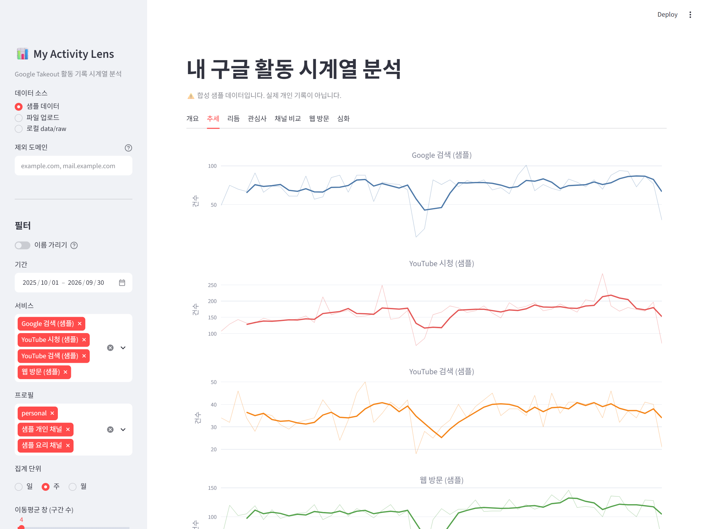
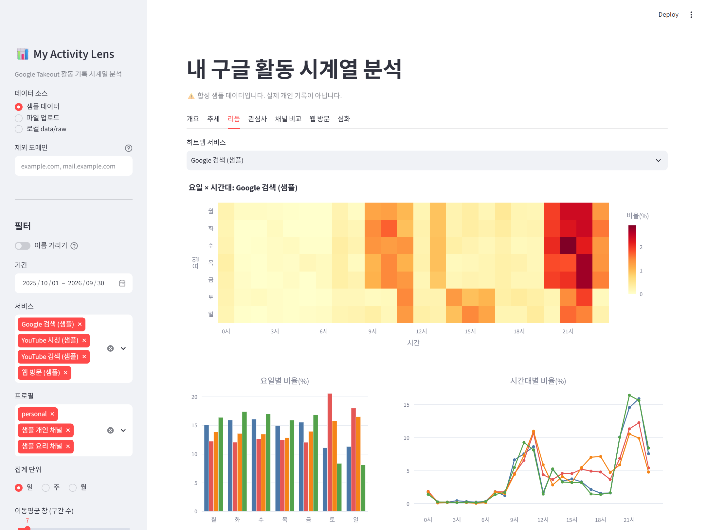
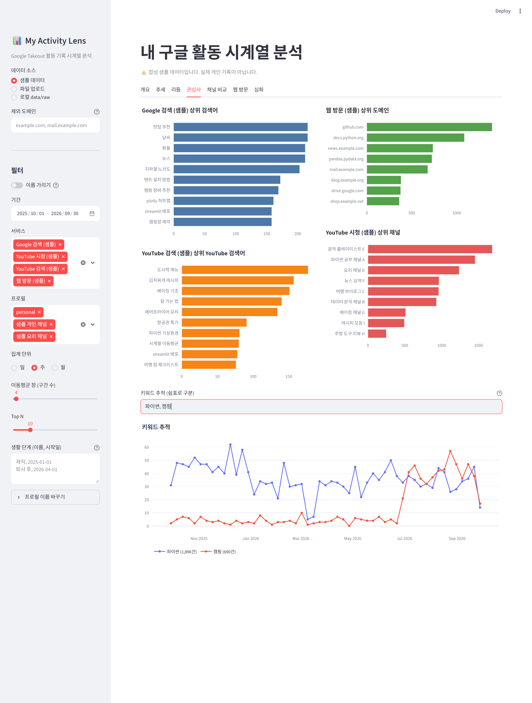
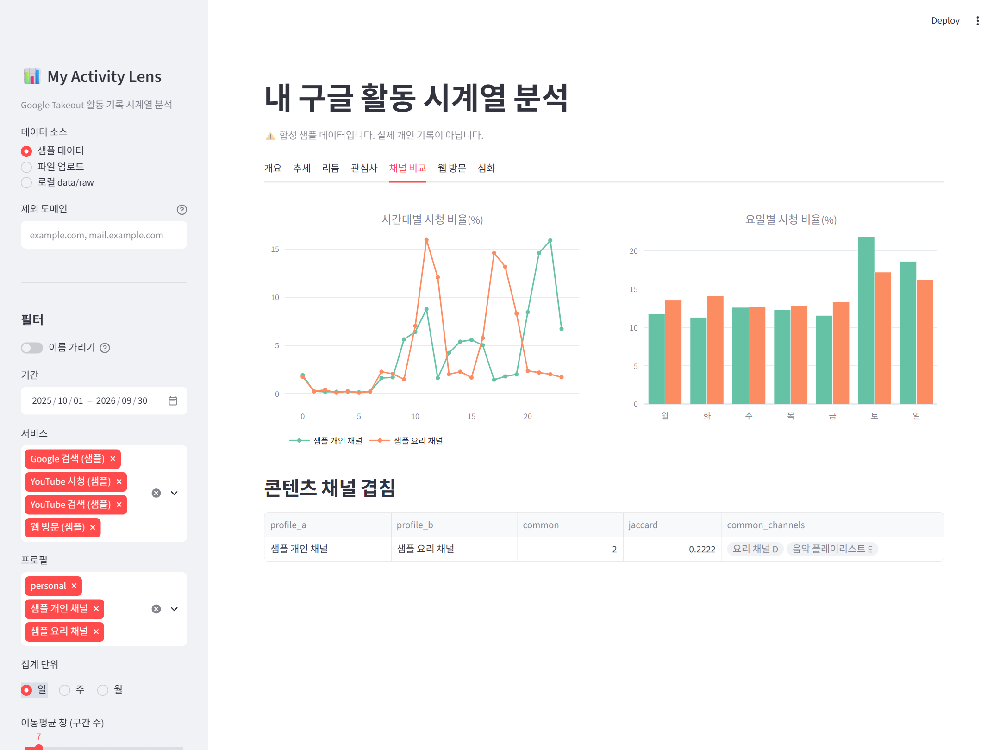

# My Activity Lens: 내 구글 활동 시계열 분석

Google Takeout으로 받은 **Chrome 방문 기록**과 **YouTube 시청 기록**을 시계열로 분석해, 퇴사와 AI 학습이라는 생활 변화가 디지털 습관을 어떻게 바꿨는지 살펴본 프로젝트입니다.
분석 리포트, 분석 노트북, 기간·조건을 바꿔 탐색하는 Streamlit 대시보드로 구성됩니다.


## 핵심 결과

자세한 근거와 해석은 [REPORT.md](REPORT.md)에 있습니다.

1. **웹 사용량은 생활 단계에 따라 20배 넘게 달라졌다.** 일평균 방문이 재직 2.8건 → AI 교육 58.8건 → AI 과정 37.5건으로 바뀌었다.
2. **퇴사 후 웹 사용의 중심이 밤에서 낮으로 옮겨 갔다.** 피크 시간이 22시에서 14시로 바뀌었고, 저녁·심야 비율이 48%에서 11~14%로 줄었다.
3. **YouTube는 생활 변화와 거의 무관한 밤 습관이다.** 단계와 상관없이 하루 27~34건을 보며, 시청의 52~68%가 저녁·심야다.
4. **AI 교육 시기에 넓게 탐색하고, AI 과정 시기에 좁혀 썼다.** 방문한 고유 도메인이 84개에서 423개로 늘었고, 이후 상위 5개 도메인의 비율이 다시 높아졌다.

## 결과물

| 파일 | 내용 |
|------|------|
| [REPORT.md](REPORT.md) | 분석 리포트: 주제, 질문, 데이터, 정제 기준, 시각화 8개, 인사이트 4개, 결론·한계, **AI 사용 로그**, 재현 방법 |
| [analysis.ipynb](analysis.ipynb) | 분석 노트북. 실행하면 리포트 그래프를 `images/`에 다시 만든다 |
| [app.py](app.py) | Streamlit 대시보드 (보너스: 분석 결과 서비스화) |
| [prd.md](prd.md) | 요구사항 정의서: 데이터 명세, 정제 규칙, 기능·비기능 요구사항, 범위 변경 기록 |
| [future_plan.md](future_plan.md) | 향후 계획: STL 분해, 베이스라인 예측, 대시보드 배포 |
| [project.md](project.md) | 과제 설명 원문 |

## 과제 요구사항 대응

| project.md 요구사항 | 대응 |
|---------------------|------|
| 시계열 데이터 1개, 100개 이상 데이터 포인트 | Chrome 방문 일별 366개, YouTube 시청 일별 327개 (REPORT 3절) |
| 데이터 출처·기간 명시 | Google Takeout, 2025-10-22 ~ 2026-10-22 (REPORT 3절) |
| 분석 질문 3개 이상 | 5개: 추세, 주기성, 급변 구간, 관심사 변화, 생활 단계 비교 (REPORT 2절) |
| 기본 정보·결측·이상치 처리 | 활동 없는 날은 0, 7일 넘는 0은 기록 중단 구간으로 표시, 이상치는 `Q3+3×IQR`로 표시만 함 (REPORT 4절) |
| 시계열 기법 2개 이상 | 이동평균(7·28일), 주간 변화율, 요일·시간대 집계, 구간별(생활 단계) 통계 |
| 시각화 2개 이상 (권장 3개) | 8개 (`images/01`~`09`) |
| 인사이트 3개 이상, 관찰과 해석 구분 | 4개, 관찰(Fact)·원인 가설(Why)·행동(Action) 형식 (REPORT 6절) |
| AI 사용 로그 | 사용 작업·이유·검증 방법 (REPORT 8절) |
| 재현성 | `requirements.txt` 버전 고정, 실행 명령, 데이터 출처·개인정보 주의 문구 |
| 보너스: 서비스화 | Streamlit 대시보드. 제출 방식 3번(스크린샷 세트 + 시나리오 설명)은 [아래](#대시보드-스크린샷과-탐색-시나리오) |
| 보너스: 분해·예측 | 이번 제출에서는 보류, [future_plan.md](future_plan.md)에 계획 |

## 폴더 구조

```text
M1-1/
├── REPORT.md                # 분석 리포트
├── analysis.ipynb           # 분석 노트북 (출력은 지운 상태로 커밋)
├── app.py                   # Streamlit 대시보드
├── prd.md / future_plan.md  # 요구사항 정의서 / 향후 계획
├── requirements.txt         # 의존성 (버전 고정)
├── pytest.ini
├── src/
│   ├── loader.py            # Takeout zip·JSON·CSV 읽기, 데이터 종류 판별
│   ├── parser.py            # 레코드 → events 표, 정제 규칙
│   ├── profiles.py          # 프로필(내 채널) 식별, 병합·중복 제거
│   ├── datasource.py        # 실제·샘플 데이터 선택, 폴더·업로드 묶기
│   ├── features.py          # 일·주·월 집계, 이동평균, 변화율, 이상치, 생활 단계
│   ├── privacy.py           # 도메인·채널·검색어 이름 가리기
│   ├── viz.py               # 리포트용 matplotlib 그래프
│   ├── charts.py            # 대시보드용 Plotly 차트
│   ├── dashboard.py         # 대시보드 보조 함수
│   └── make_sample.py       # 합성 샘플 데이터 생성
├── tests/                   # pytest 49개
├── images/                  # 리포트 그래프, 대시보드 스크린샷
└── data/
    ├── raw/                 # 본인 Takeout 데이터 (커밋하지 않음)
    └── sample/              # 합성 샘플 데이터 (개인정보 없음)
```

## 실행 방법

### 1. 가상환경과 설치

`M1-1/` 폴더에서 실행한다. Python 3.10 이상이 필요하다(개발 환경 3.13.5).

```bash
python -m venv .venv
```

| 셸 | 활성화 명령 |
|----|------------|
| Git Bash (Windows) | `source .venv/Scripts/activate` |
| macOS / Linux | `source .venv/bin/activate` |
| cmd | `.venv\Scripts\activate.bat` |
| PowerShell | `.venv\Scripts\Activate.ps1` |

```bash
pip install -r requirements.txt
```

### 2. 테스트

```bash
python -m pytest
```

### 3. 분석 노트북

```bash
jupyter nbconvert --to notebook --execute --inplace analysis.ipynb
```

- VS Code에서 열 때는 커널로 `.venv`의 Python을 고른다.
- `data/raw/`에 데이터가 없으면 합성 샘플 데이터로 실행되고, 그래프에 "(샘플)"이 표시된다. 이때 리포트 그림(`images/`)은 덮어쓰지 않는다.

### 4. 대시보드

```bash
streamlit run app.py
```

브라우저에서 `http://localhost:8501`이 열린다. 데이터 소스는 사이드바에서 고른다.
- **샘플 데이터**: 기본값
- **파일 업로드**: Takeout zip·json·csv 여러 개. 메모리에서만 처리하고 저장하지 않는다
- **로컬 data/raw**: `data/raw/`에 데이터가 있을 때만 나타난다

## 내 데이터 준비 (Google Takeout)

1. https://takeout.google.com 에서 "모두 선택 해제"를 누른다.
2. 아래 항목을 고르고, 형식을 **JSON**으로 바꿔 내보낸다. 자세한 절차는 [prd.md](prd.md) 4.1절에 있다.
   - **YouTube 및 YouTube Music**: "기록"과 "채널"
   - **내 활동 > Chrome** (웹 및 앱 활동에서 Chrome 기록이 켜져 있어야 함)
3. 받은 파일을 `data/raw/`에 넣는다.
   - zip은 그대로 두면 파일 하나가 내보내기 하나로 처리된다.
   - 낱개 JSON·CSV를 바로 넣으면 하나로 묶인다. 이때 `채널.csv`가 같은 폴더의 시청 기록과 연결된다.
   - YouTube 채널(브랜드 계정)이 여러 개면 `data/raw/brand-요리/`처럼 채널마다 하위 폴더를 만든다.

## 개인정보 보호

- `data/raw/`의 원본은 `.gitignore`로 커밋을 막는다.
- 웹 방문은 **도메인만** 남기고 URL 경로·쿼리·페이지 제목은 파싱 단계에서 버린다. 위치 정보도 읽지 않는다.
- 리포트 그래프의 도메인·채널 이름은 "도메인 1", "채널 1"처럼 가린다.
  - 노트북을 실행하면 `doc/domain_review.md`, `doc/channel_review.md`(로컬 전용)가 생긴다.
  - 여기서 공개할 이름만 `[x]`로 체크하면, 다시 실행할 때 체크한 이름만 실명으로 나온다.
- 대시보드는 본인 데이터를 실명으로 보여 준다. 화면을 공유할 때는 사이드바의 **이름 가리기**를 켠다.

## 대시보드 스크린샷과 탐색 시나리오

보너스 서비스화 제출 방식 3번(스크린샷 세트 + 필터·기간 변경 시나리오)이다. 화면은 모두 **합성 샘플 데이터**다.

**시나리오: "1년 동안 내 온라인 활동은 어떻게 흘러왔나?"**

1. **개요**: KPI(총 이벤트, 기간, 일평균, 최다 활동일)와 데이터 품질(파싱 통계, 기록 중단 구간)을 먼저 확인한다.
   
2. **추세 (일 단위)**: 서비스별 일별 건수와 7일 이동평균을 본다. 동그라미는 이상치(몰아보기 날)다.
   
3. **집계 단위를 "주"로 바꾸기**: 하루 단위 잡음이 사라지고, 3월의 기록 중단 구간과 큰 흐름이 또렷해진다.
   
4. **리듬**: 요일×시간 히트맵에서 검색은 평일 오전·밤, 주말 오후에 몰린다는 것을 확인한다.
   
5. **관심사와 키워드 추적**: 상위 검색어·채널·도메인을 보고, "파이썬, 캠핑"을 추적한다. 7월부터 캠핑 관련 활동이 늘어난 것이 보인다.
   
6. **채널 비교**: 내 채널(프로필) 2개의 시청 시간대를 비교한다. 개인 채널은 밤, 요리 채널은 점심·저녁 시간대에 몰린다. 공통 콘텐츠 채널은 2개다.
   

이 밖에 사이드바에서 기간·서비스·프로필을 좁히거나, 제외 도메인을 넣거나, 생활 단계를 입력해 "생활 단계" 탭에서 단계별로 비교할 수 있다.

## 기술 스택

| 영역 | 선택 | 이유 |
|------|------|------|
| 언어 | Python 3.13 (3.10 이상) | 과제 요구사항 |
| 데이터 처리 | pandas 3.0, numpy 2.5 | 시계열 리샘플링·롤링 연산 |
| 리포트 그래프 | matplotlib 3.11, seaborn 0.13 | PNG로 저장해 리포트에 넣기 쉬움 |
| 대시보드 | Streamlit 1.66, Plotly 7.1 | 순수 Python으로 빠르게 만들고, 확대·툴팁 같은 상호작용 제공 |
| 시계열 심화 | statsmodels 0.15 | STL 분해 (향후 계획) |
| 테스트 | pytest 9.1, Streamlit AppTest | 정제 규칙과 대시보드 실행을 자동 검증 |
| 환경 | `venv` | 별도 설치 없이 프로젝트 전용 환경 |

## 데이터 출처와 주의

- 데이터: 본인 Google 계정의 Google Takeout 내보내기. 개인 기록이므로 저장소에는 포함하지 않는다.
- `data/sample/`: `src/make_sample.py`로 만든 합성 데이터다(시드 고정). 실존 개인 정보가 없다.
- 분석은 방문·시청 **이벤트 수** 기준이며 사용 시간은 반영하지 않는다. 그 밖의 한계는 REPORT 7절에 정리했다.
