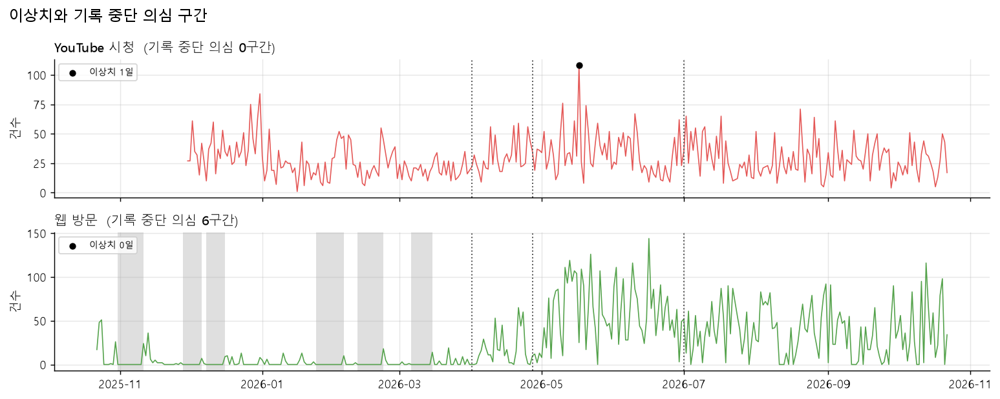
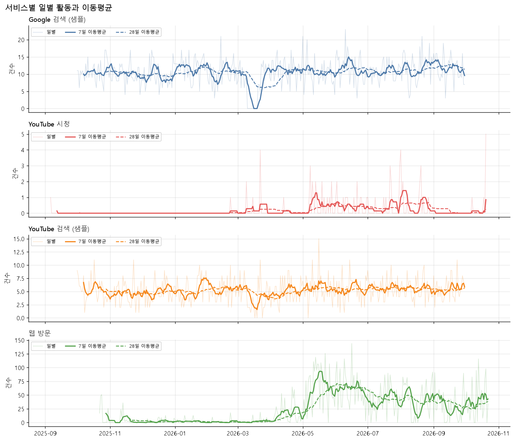
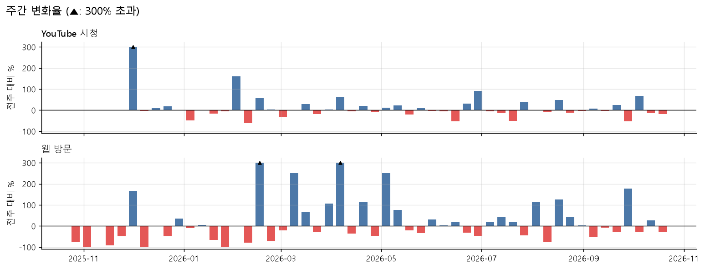
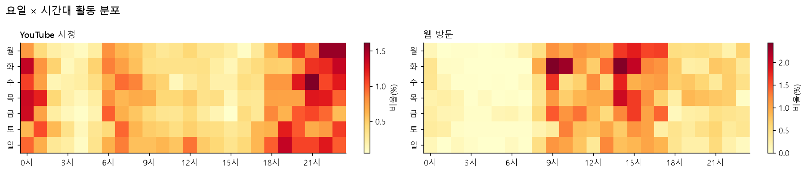
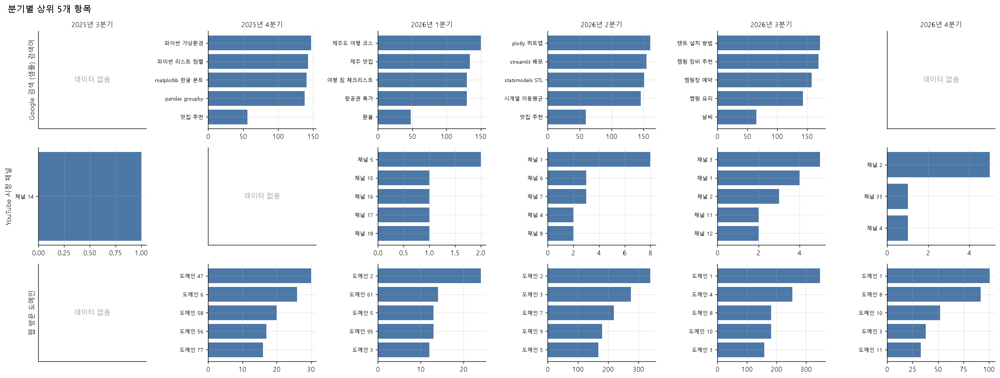
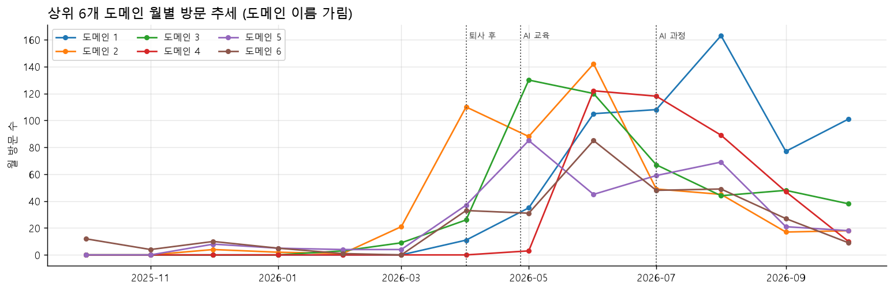
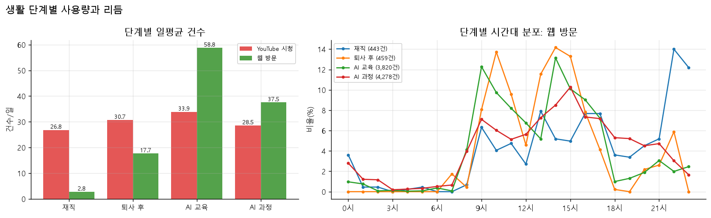
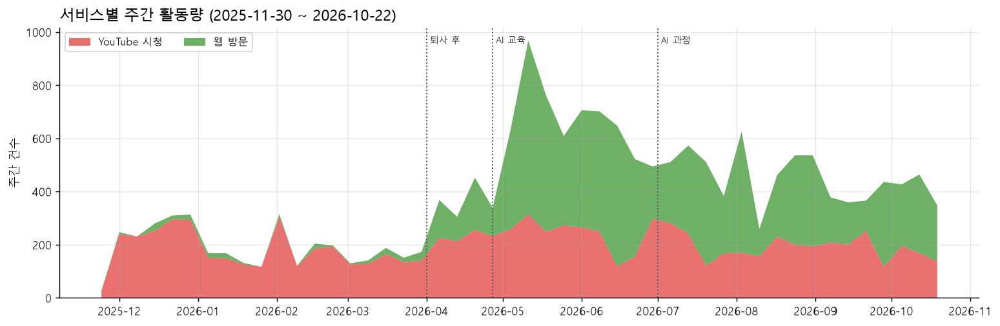

# 내 구글 활동 시계열 분석 리포트: 퇴사와 AI 학습이 디지털 습관을 어떻게 바꿨나

- 작성일: 2026-10-22
- 데이터: Google Takeout으로 받은 본인 계정의 **Chrome 방문 기록**과 **YouTube 시청 기록** (실제 데이터)
- 코드: [analysis.ipynb](analysis.ipynb), [src/](src/) / 요구사항 정의: [prd.md](prd.md)

---

## 1. 분석 주제와 선정 이유

2026년 3월 말 퇴사했고, 4월 말부터 6월 말까지 AI 교육을 받았으며, 7월부터 AI 도구 활용 과정을 진행하고 있다.
생활이 크게 바뀐 1년 동안 **웹 브라우징과 YouTube 시청 습관이 실제로 어떻게 달라졌는지**를 내 활동 기록으로 확인하고 싶었다.

Google 계정에는 방문과 시청이 초 단위로 기록된다. 이 기록을 일별 시계열로 바꾸면 추세, 요일·시간대 주기, 급변 구간을 데이터로 볼 수 있다.

## 2. 분석 질문

| # | 질문 | 다룬 절 |
|---|------|---------|
| Q1 | 1년 동안 웹 방문과 YouTube 시청은 늘었나, 줄었나? 두 활동은 같은 방향으로 움직이나? | 5.1 |
| Q2 | 요일·시간대 패턴이 있나? 평일과 주말, 주간과 저녁의 차이는? | 5.2 |
| Q3 | 사용량이 튄 날과 기록이 끊긴 구간은 언제인가? | 5.3 |
| Q4·Q7 | 자주 가는 사이트와 보는 채널은 시기에 따라 바뀌었나? | 5.4 |
| Q8 | 재직 → 퇴사 후 → AI 교육 → AI 과정 단계마다 사용량과 리듬이 어떻게 달라졌나? | 5.5 |

- Google 검색·YouTube 검색 기록은 실제 데이터를 확보하지 못해 이번 분석에서 제외했다 (PRD 1.4).
- 내 채널(브랜드 계정) 비교(Q6)는 실제 데이터의 채널이 하나뿐이라 다루지 않았다.

## 3. 데이터 설명

| 항목 | Chrome 방문 기록 | YouTube 시청 기록 |
|------|------------------|-------------------|
| 출처 | Google Takeout > 내 활동 > Chrome (JSON) | Google Takeout > YouTube 및 YouTube Music > 기록 (JSON) |
| 기간 (KST) | 2025-10-22 ~ 2026-10-22 (366일) | 2025-11-30 ~ 2026-10-22 (327일) |
| 원본 레코드 | 15,410건 | 9,600건 (YouTube Music 재생 109건 포함) |
| 정제 후 이벤트 | **9,000건** | **9,528건** |
| 활동 있는 날 | 228일 | 327일 (모든 날) |
| 시계열 단위 | 일별 방문 수 (366개 데이터 포인트) | 일별 시청 수 (327개 데이터 포인트) |

- **수집 방법**: takeout.google.com에서 해당 항목을 JSON 형식으로 내보냈다. 절차는 [prd.md](prd.md) 4.1절에 있다.
- **시간대**: 원본은 UTC다. 모두 KST(Asia/Seoul)로 바꾼 뒤 날짜·요일·시간을 계산했다.
- **개인정보 주의**
  - 원본 데이터는 개인 기록이라 저장소에 올리지 않는다(`data/raw/`는 `.gitignore` 대상).
  - 웹 방문은 **도메인만** 남기고 URL 경로·쿼리·페이지 제목은 파싱 단계에서 버렸다.
  - 그래프와 표의 도메인·채널 이름은 "도메인 1", "채널 1"처럼 방문·시청 빈도 순위로 가렸다.
  - 저장소의 `data/sample/`은 재현과 데모를 위한 **합성 데이터**이며, 이 리포트의 수치에는 쓰지 않았다.

## 4. 데이터 정제

### 4.1 레코드 단위 정제 (파싱 단계)

| 규칙 | Chrome | YouTube | 이유 |
|------|--------|---------|------|
| `google.com/url?q=` 래퍼를 풀어 실제 도메인만 추출 | 대부분 해당 | - | 원본 `titleUrl`의 약 76%가 Google 주소이고, 그 대부분이 `google.com/url` 리디렉션으로 감싸진 실제 방문 주소임 |
| 로컬·내부 주소, Google 검색·YouTube 페이지 방문 제외 | 1,084건 | - | 개발 서버(localhost) 접속과 다른 서비스와의 중복 집계를 막음 |
| 같은 도메인을 직전 방문 후 1분 안에 다시 방문하면 1건으로 묶음 | 5,282건 | - | 한 사이트 안에서 페이지를 옮겨 다닌 기록이 방문 수를 부풀림 |
| URL 없는 기록("Chrome을 사용함" 등) 제외 | 44건 | 72건 | 분석할 대상이 없음 |
| 삭제·비공개 영상은 "(삭제된 영상)"으로 표시하고 건수에는 포함 | - | 507건 | 시청 행동 자체는 실제로 있었음 |

원본 Chrome 기록의 **34%가 1분 안 반복 방문**이었다. 원본 건수를 그대로 쓰면 웹 활동량이 1.5배 이상 부풀려진다.

### 4.2 결측과 이상치 처리 기준

- **결측**: 활동이 없는 날은 결측이 아니라 실제 0으로 채웠다. 단, 0이 7일 넘게 이어지면 "기록 중단 의심 구간"으로 따로 표시했다.
  - Chrome: 6구간, 모두 59일. **모두 2026-03-14 이전**에 몰려 있다.
  - YouTube: 중단 구간 없음.
- **이상치**: 일별 건수가 `Q3 + 3×IQR`을 넘는 날이다. 사분위수는 활동이 있는 날만으로 계산했다(0이 많은 시계열에서 활동한 날이 모두 이상치로 잡히는 오류를 막기 위해).
  - 실제 행동일 수 있으므로 **표시만 하고 제거하지 않았다**.
  - 결과: YouTube 1일(2026-05-17 일요일, 108건, 활동일 중앙값의 4.2배). Chrome은 0일.



## 5. 분석 결과와 시각화

### 5.1 추세 (Q1): 이동평균과 변화율



- **기법**: 하루 단위 변동이 커서 7일 이동평균(주간 패턴 제거)과 28일 이동평균(한 달 흐름)을 함께 그렸다. 점선은 생활 단계의 시작일이다.

| 서비스 | 첫 8주 일평균 | 마지막 8주 일평균 | 변화율 |
|--------|--------------|------------------|--------|
| 웹 방문 | 4.5 | 35.4 | **+686%** |
| YouTube 시청 | 31.1 | 27.3 | −12% |

| 월 | 2025-11 | 2025-12 | 2026-01 | 2026-02 | 2026-03 | 2026-04 | 2026-05 | 2026-06 | 2026-07 | 2026-08 | 2026-09 |
|----|---------|---------|---------|---------|---------|---------|---------|---------|---------|---------|---------|
| 웹 방문 | 92 | 58 | 52 | 35 | 63 | 496 | **1,944** | 1,839 | 1,256 | 1,273 | 863 |
| YouTube 시청 | 27* | 1,198 | 627 | 809 | 612 | 925 | **1,200** | 876 | 954 | 842 | 871 |

\* YouTube 기록은 2025-11-30부터 시작한다.



- **기법**: 주간 합계의 전주 대비 변화율(%)로 변동성을 비교했다.
- 웹 방문은 주간 변화율 중앙값(절댓값)이 **46.4%**로 크게 출렁인다. YouTube는 **16.7%**로 안정적이다.
- 두 서비스의 주간 합계 상관계수는 **0.23**으로 약하다. 두 활동은 서로 독립적으로 움직인다.

### 5.2 주기성 (Q2): 요일·시간대 집계



| 서비스 | 평일 일평균 | 주말 일평균 | 주말/평일 | 피크 시간 | 오전(6~11시) | 오후(12~17시) | 저녁(18~23시) | 심야(0~5시) |
|--------|------------|------------|----------|----------|-------------|--------------|--------------|------------|
| 웹 방문 | 26.9 | 18.8 | 0.70배 | 14시 | 28.4% | **48.4%** | 19.3% | 4.0% |
| YouTube 시청 | 28.2 | 31.4 | 1.11배 | 22시 | 23.9% | 14.7% | **41.5%** | **20.0%** |

- 웹 방문은 **평일 낮**(9~10시, 14~15시)에 몰려 있고, YouTube는 **매일 밤**(20~24시)과 심야에 몰려 있다. 두 활동의 시간대가 거의 겹치지 않는다.

### 5.3 급변 구간 (Q3)

- **2026년 4월**: 웹 방문이 월 63건(3월)에서 496건(4월), 1,944건(5월)으로 급증했다. 퇴사(3월 말)와 AI 교육 시작(4월 말) 시점과 겹친다.
- **기록 중단 구간**: Chrome 기록이 끊긴 6구간이 모두 퇴사 전에 있다.
- **YouTube 이상치**: 2026-05-17(일)에 108건으로 튀었다. 그날 상위 채널은 서로 다른 3개 채널(가린 이름: 채널 141, 46, 21)로, 한 채널을 몰아본 날이 아니라 여러 채널을 넘나든 날이다.

### 5.4 관심사 변화 (Q4·Q7): 구간별 상위 항목





- 상위 10개 도메인이 전체 방문의 **41.3%**를 차지한다.
- 분기마다 1위 도메인이 바뀐다. 2026년 2분기에는 "도메인 2·3"이, 3분기 이후에는 "도메인 1"이 1위다. 이름을 가려 구체적인 사이트는 밝히지 않는다.

### 5.5 생활 단계 비교 (Q8): 구간별 통계

단계 경계일은 사용자 일정을 날짜로 옮긴 추정값이다: 재직(~2026-03-31), 퇴사 후(04-01~04-26), AI 교육(04-27~06-30), AI 과정(07-01~).



**웹 방문**

| 단계 | 일수 | 활동 있는 날 | 일평균 | 주말/평일 | 피크 | 오전 | 오후 | 저녁·심야 | 고유 도메인 | 상위 5개 비율 |
|------|------|-------------|--------|----------|------|------|------|----------|------------|--------------|
| 재직 | 161 | 27% | 2.8 | 0.89배 | 22시 | 15.8% | 36.1% | **48.1%** | 79 | 29.8% |
| 퇴사 후 | 26 | 85% | 17.7 | 0.62배 | 14시 | 33.6% | **55.6%** | 10.9% | 84 | **52.1%** |
| AI 교육 | 65 | 98% | **58.8** | 0.67배 | 14시 | 34.8% | 51.4% | 13.8% | **423** | 25.0% |
| AI 과정 | 114 | 86% | 37.5 | 0.74배 | 15시 | 23.4% | 46.2% | 30.4% | 406 | 33.1% |

**YouTube 시청**

| 단계 | 일평균 | 평일 | 주말 | 주말/평일 | 피크 | 저녁·심야 |
|------|--------|------|------|----------|------|----------|
| 재직 | 26.8 | 25.3 | 30.6 | 1.21배 | 21시 | 67.7% |
| 퇴사 후 | 30.7 | 28.1 | 36.6 | 1.31배 | 0시 | 60.7% |
| AI 교육 | **33.9** | 32.0 | 38.9 | 1.22배 | 20시 | 65.6% |
| AI 과정 | 28.5 | 29.2 | 26.8 | **0.92배** | 23시 | 52.6% |



## 6. 인사이트

### 인사이트 1. 웹 사용량은 생활 단계에 따라 20배 넘게 달라졌다
- **관찰 (Fact)**
  - 웹 방문 일평균이 재직 2.8건 → 퇴사 후 17.7건 → AI 교육 **58.8건** → AI 과정 37.5건으로 바뀌었다.
  - 활동 있는 날의 비율도 27%에서 98%로 늘었다.
  - Chrome 기록 중단 의심 구간 6개(59일)는 모두 퇴사 전에 있다.
- **원인 가설 (Why)**
  1. 재직 중에는 회사 PC·회사 계정으로 웹을 써서, 개인 계정의 Chrome 기록에 거의 남지 않았다. 기록 중단 구간이 퇴사 전에만 있다는 점이 이 가설을 뒷받침한다.
  2. AI 교육은 문서, 코드 저장소, 클라우드 도구를 오가는 웹 기반 실습이 많아 방문 수가 크게 늘었다.
  - 1은 "실제 사용이 적었다"가 아니라 "기록 범위가 달랐다"는 뜻이다. 그래서 재직 구간을 다른 단계와 같은 기준으로 비교하면 안 된다.
- **행동 (Action)**
  - 웹 사용량 추세는 개인 계정만 쓰기 시작한 **2026-04 이후 데이터로 판단**한다.
  - 이 기준으로 보면 AI 교육(58.8) → AI 과정(37.5)은 **36% 감소**다. 정규 교육에서 자율 과정으로 바뀌며 웹 작업량이 줄었는지, 다른 도구(데스크톱 앱 등)로 옮겨 갔는지 확인한다.

### 인사이트 2. 퇴사 후 웹 사용의 중심이 "밤"에서 "낮"으로 옮겨 갔다
- **관찰 (Fact)**
  - 재직 시기 웹 방문은 피크가 22시이고 저녁·심야 비율이 48.1%였다.
  - 퇴사 후와 AI 교육 시기에는 피크가 14시로 바뀌고, 저녁·심야 비율이 10.9~13.8%로 떨어졌으며, 오전 비율은 33.6~34.8%로 두 배가 됐다.
  - AI 과정 시기에는 저녁·심야 비율이 다시 30.4%로 올랐다.
- **원인 가설 (Why)**
  - 재직 중 개인 웹 사용은 퇴근 후에만 가능했다.
  - 퇴사 후에는 낮 시간이 학습 시간이 되었고, AI 교육은 주간 일정으로 진행됐다.
  - AI 과정은 일정이 자율적이고 과제가 있어 저녁 작업이 다시 늘었다.
- **행동 (Action)**
  - 집중도가 높은 오전(9~10시)과 오후(14~15시) 블록을 학습 시간으로 고정한다.
  - AI 과정 기간의 저녁 작업 비율(30%)이 계속 오르는지 월별로 살핀다.

### 인사이트 3. YouTube는 생활 변화와 거의 무관한 "밤 습관"이다
- **관찰 (Fact)**
  - 단계별 YouTube 일평균은 26.8~33.9건으로 폭이 ±12% 수준이다(웹은 20배 차이).
  - 저녁·심야 비율이 모든 단계에서 52~68%이고, 전체 시청의 20%가 0~5시다.
  - 웹 방문과의 주간 상관계수는 0.23으로 낮다.
  - 단, AI 과정 시기에만 주말/평일 비율이 1.2배 안팎에서 **0.92배로 역전**됐다.
- **원인 가설 (Why)**
  - YouTube는 하루를 마무리하는 휴식 습관이어서 일과가 바뀌어도 유지된다.
  - AI 과정 시기에는 주말을 과제·학습에 쓰면서 주말 시청이 줄었다.
  - AI 교육 시기가 33.9건으로 가장 많은 것은 학습 보조 영상 시청 때문일 수 있다. 채널 이름을 가려 이 리포트에서는 검증하지 못했다.
- **행동 (Action)**
  - 심야(0~5시) 시청 20%는 수면 시간과 겹치므로, 자정 이후 시청 알림이나 제한을 걸어 본다.
  - 채널을 학습·여가로 분류해 "AI 교육 시기 증가분이 학습 영상인가"를 검증한다.

### 인사이트 4. AI 교육 시기에 "넓게 탐색"하고, AI 과정 시기에 "좁혀 쓰는" 흐름이 보인다
- **관찰 (Fact)**
  - 방문한 고유 도메인은 퇴사 후 84개에서 AI 교육 **423개**로 5배 늘었고, 상위 5개 도메인 비율은 52.1%에서 **25.0%**로 떨어졌다.
  - AI 과정 시기에는 고유 도메인 406개로 비슷하지만, 상위 5개 비율이 **33.1%**로 다시 올랐고 1위 도메인이 바뀌었다(가린 이름: 도메인 1, 449건).
- **원인 가설 (Why)**
  - 교육 기간에는 여러 AI 도구와 문서를 넓게 써 보며 탐색했다.
  - 과정 기간에는 자주 쓰는 소수의 도구로 작업이 모였다.
- **행동 (Action)**
  - 도메인을 "AI 도구 / 문서·학습 / 협업 / 여가"로 분류해(PRD FR-23) 탐색에서 집중으로 넘어가는 흐름을 수치로 검증한다.
  - 자주 쓰는 도구에는 바로가기와 템플릿을 만들어 둔다.

## 7. 결론과 한계

### 결론
- **웹 사용**은 생활 단계에 크게 반응했다. 퇴사 이후 낮 시간 중심의 학습형 사용으로 바뀌었고, 교육 시기에 정점(일평균 58.8건)을 찍은 뒤 과정 시기에는 소수 도구 중심으로 좁혀졌다.
- **YouTube 시청**은 단계와 상관없이 하루 약 30건, 밤 시간대에 집중된 습관으로 유지됐다.
- 생활 변화는 "얼마나 쓰는가"보다 **"언제, 무엇을 쓰는가"**를 바꿨다.

### 한계
- **기록 범위**: 재직 시기의 웹 사용이 적은 것은 회사 기기·계정을 쓴 영향일 가능성이 크다(인사이트 1). 그래서 재직 시기와 이후를 같은 기준으로 비교할 수 없다.
- **방문·시청 수 ≠ 사용 시간**: 이벤트 수만 있고 체류·재생 시간은 없다. 1분 반복 방문 묶기 기준(60초)도 임의로 정한 값이다.
- **이름 가림**: 도메인과 채널 이름을 가려 내용(무엇을 봤는지)에 대한 해석은 가설에 머문다.
- **단계 경계일**: "3월 말", "4월 말"을 날짜로 옮긴 추정값이다. 경계일을 며칠 옮기면 단계별 수치가 조금 달라진다.
- **기기 구분 불가**: 여러 기기의 기록이 섞여 있고 기기별로 나눌 수 없다.
- **YouTube Music 포함**: 시청 기록에 YouTube Music 재생 109건(1.1%)이 섞여 있다.
- **분석 제외**: 검색 기록은 실제 데이터가 없어 분석하지 못했다.
- **상관 ≠ 인과**: 생활 단계와 사용 패턴의 동시 변화는 인과관계를 증명하지 않는다.

## 8. AI 사용 로그

이 프로젝트는 Claude Code(AI 코딩 에이전트)와 함께 진행했다. 단계마다 계획을 보고받고 승인한 뒤 진행했고, 결과물은 직접 확인했다.

| 사용 작업 | 사용 이유 | 검증 방법 |
|-----------|-----------|-----------|
| 요구사항 정의(PRD) 초안 작성, Takeout 데이터 구조 조사 | 시간 절감, 설계 대안 탐색 (다중 채널, Chrome 기록 포함 여부 등) | 초안을 검토해 수정을 요청하고 승인. AI가 "실제 파일로 확인하지 않음"이라고 표시한 부분은 실제 내보내기 파일로 다시 확인 |
| 실제 데이터 구조 확인 | 원본 내용을 노출하지 않고 구조만 파악 | 건수·필드·패턴만 출력하게 해 확인. 그 결과 `google.com/url` 래퍼, `page_transition` 필드 없음을 발견해 설계를 고침 |
| 파서·정제·집계 코드 작성 (`src/`) | 시간 절감 | pytest 테스트 42개(직접 만든 레코드 + 합성 샘플)로 정제 규칙을 하나씩 검증 |
| 합성 샘플 데이터 생성 | 개인정보 없이 개발·테스트·데모 | 의도적으로 넣은 이상치·중단 구간·광고·중복이 정확히 검출되는지 테스트로 확인 |
| 오류 발견과 수정 | 검증 | 노트북 출력을 검토하다 ① 0이 많은 시계열에서 활동일 전체가 이상치로 잡히는 오류 ② 낱개 `채널.csv`가 시청 기록과 연결되지 않는 문제를 발견해 수정 |
| 시각화 코드 작성 (`src/viz.py`) | 대안 탐색 (차트 유형) | 생성된 PNG를 직접 보고 빈 분기 표시 등을 수정. 그래프 수치는 노트북 표와 대조 |
| 인사이트 초안 작성 | 다른 관점 탐색 | 모든 수치는 노트북 출력에서 가져옴. 원인 가설은 본인이 제공한 생활 일정(퇴사·교육·과정)과 대조했고, 검증하지 못한 가설은 "가설"로 표시 |
| 문장 다듬기 | 가독성 | 최종 해석과 결론은 본인이 검토·확정 |

## 9. 재현 방법

```bash
python -m venv .venv
source .venv/Scripts/activate        # Windows cmd: .venv\Scripts\activate.bat
pip install -r requirements.txt
python -m pytest                      # 테스트 42개
jupyter nbconvert --to notebook --execute --inplace analysis.ipynb
```

- 본인 데이터로 실행하려면 Takeout JSON을 `data/raw/`에 넣는다. 데이터가 없으면 노트북이 합성 샘플(`data/sample/`)로 실행되며, 이때는 리포트 그림(`images/`)을 덮어쓰지 않는다.
- 그래프는 `images/`에 저장된다. 공개할 도메인·채널은 실행 후 생기는 `doc/domain_review.md`, `doc/channel_review.md`에서 체크하고 다시 실행한다.
- 의존성 버전은 [requirements.txt](requirements.txt)에 고정되어 있다 (Python 3.10 이상, 개발 환경 3.13.5).
