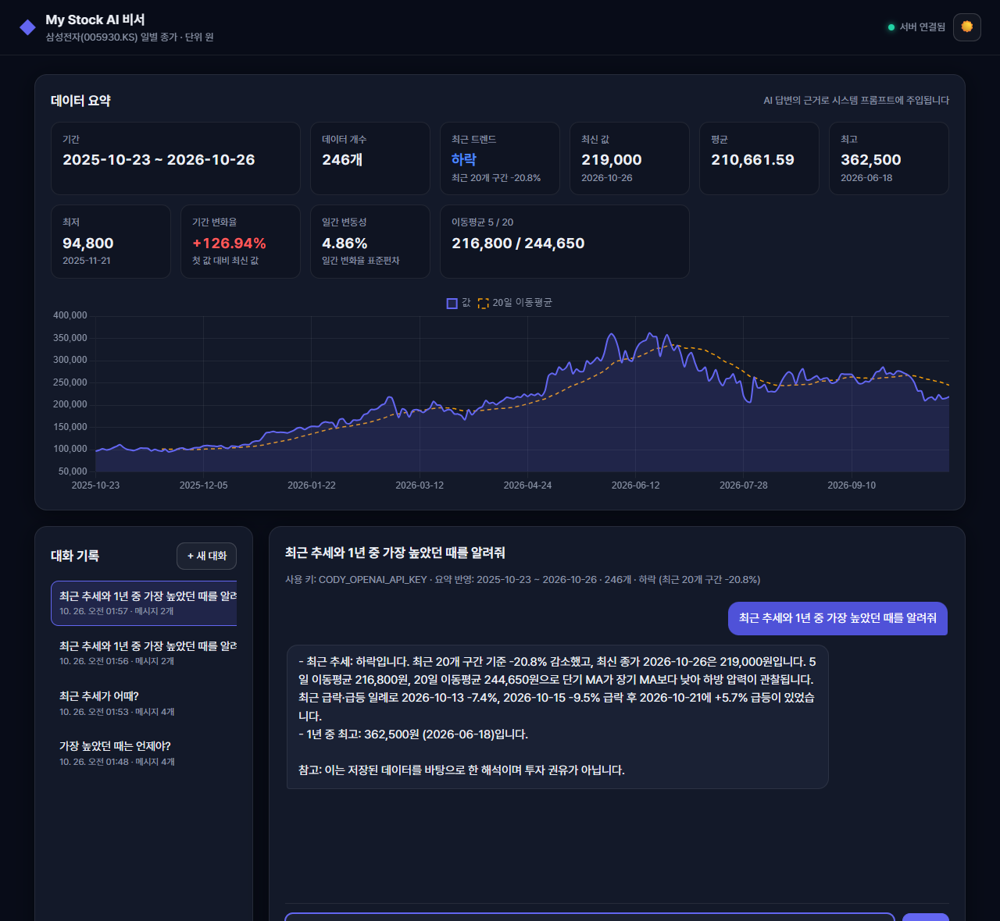
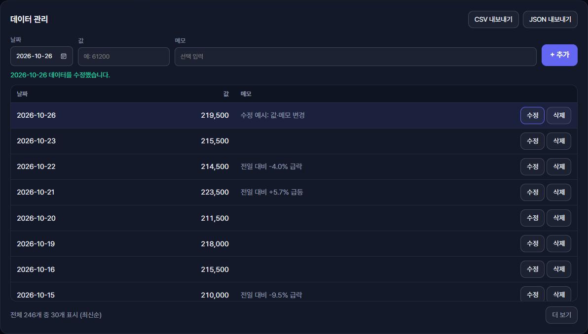
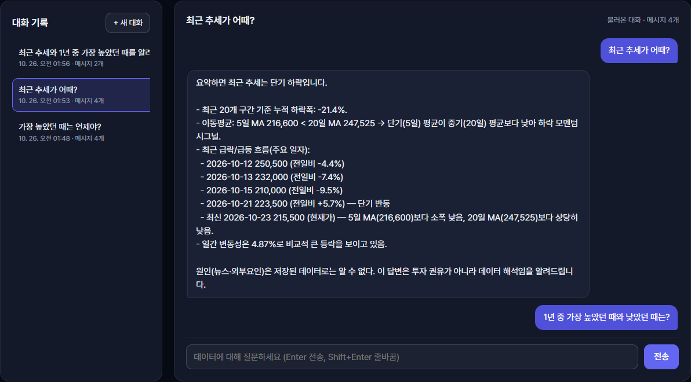

# My Stock AI 비서

> M1-2 미션 "내 데이터를 아는 AI 비서 만들기" 결과물

일반 챗봇은 내 데이터를 모릅니다. 이 서비스는 **삼성전자(005930.KS) 1년치 일별 종가(245개)** 를 Firestore에 저장하고,
그 요약(기간·개수·통계·추세·월별 통계·최근 값)을 **GPT 시스템 프롬프트에 주입**해서 "최근 추세가 어때?", "가장 높았던 때는?" 같은 질문에
실제 수치와 날짜로 답합니다. 데이터를 추가·수정·삭제하면 요약과 AI 답변에 바로 반영되고, 대화는 자동으로 저장돼 나중에 다시 불러올 수 있습니다.

## 배포 URL

| 구분 | URL |
| --- | --- |
| 프론트엔드 (Vercel) | https://ai-codyssey-frontend.vercel.app |
| 백엔드 API (Render) | https://mystock-ai-api.onrender.com |
| Swagger UI | https://mystock-ai-api.onrender.com/docs |

> Render 무료 티어는 15분간 요청이 없으면 잠듭니다. 첫 접속 시 프론트가 `/health` 를 호출하며
> "서버를 깨우는 중" 배너를 띄우고, 깨어날 때까지(최대 90초) 자동으로 재시도합니다.

## 기술 스택

| 영역 | 사용 기술 |
| --- | --- |
| 백엔드 | Python 3.13, FastAPI, Pydantic v2, Uvicorn |
| DB | Firebase Firestore (`firebase-admin`) |
| AI | 1순위 Codyssey OpenAI 호환 프록시(`gpt-5-mini`, httpx) → 실패 시 OpenAI 공식 API(`openai` SDK, `gpt-4o-mini`) |
| 프론트엔드 | HTML / CSS / JavaScript (프레임워크 없음), Chart.js |
| 배포 | Render (백엔드), Vercel (프론트엔드) |

## 폴더 구조

```
M1-2/
├── backend/
│   ├── main.py              # FastAPI 앱, CORS, 라우터 등록, /health
│   ├── core/config.py       # 환경 변수 로딩
│   ├── routers/             # HTTP 계층: data, conversations, chat
│   ├── services/            # 비즈니스 로직: repository(Firestore/메모리), summary, llm, chat, seed
│   ├── schemas/             # Pydantic 요청·응답 모델 (입력 검증)
│   ├── scripts/seed_data.py # Yahoo Finance 수집 → CSV → Firestore 업로드
│   ├── data/samsung_daily.csv
│   ├── tests/               # pytest (메모리 저장소 + 가짜 LLM)
│   ├── requirements.txt
│   └── .env.example
└── frontend/
    ├── index.html, style.css, app.js
    ├── config.js            # API 주소 (로컬 기본값)
    ├── build-config.js      # Vercel 빌드 시 API_BASE_URL → config.js 생성
    └── vercel.json
```

**분리 기준**: `routers` 는 HTTP(경로·상태 코드·예외 → 응답)만, `services` 는 계산과 저장 로직만, `schemas` 는 데이터 형태와 검증만 맡습니다.
라우터는 `Repository` 인터페이스에만 의존하므로 Firestore ↔ 메모리 저장소를 설정 하나로 바꿀 수 있고, 테스트에서는 의존성을 교체해 키 없이 검증합니다.

## API

| 메서드 | 경로 | 설명 |
| --- | --- | --- |
| POST | `/api/data` | 데이터 추가 `{date, value, memo}` — 같은 날짜가 있으면 409 |
| GET | `/api/data` | 데이터 목록 (날짜 오름차순) |
| PUT | `/api/data/{id}` | 데이터 수정 (보낸 필드만 변경) |
| DELETE | `/api/data/{id}` | 데이터 삭제 |
| GET | `/api/data/summary` | 요약: 기간, 개수, metrics(합계·평균·최고·최저·최신·변화율·변동성·이동평균), trend, monthly, recent |
| POST | `/api/conversations` | 대화 저장 `{title?, messages:[{role, content}]}` |
| GET | `/api/conversations` | 대화 목록 — **messages 미포함**(제목·메시지 수·시각만) |
| GET | `/api/conversations/{id}` | 특정 대화의 전체 messages (불러오기, 방식 A) |
| DELETE | `/api/conversations/{id}` | 대화 삭제 |
| POST | `/api/chat` | `{message, conversation_id?}` → 요약 조회 → 시스템 프롬프트 주입 → GPT 호출 → 자동 저장 |
| GET | `/health` | 헬스 체크 (콜드스타트 깨우기) |

### 입력 검증 (Pydantic)
- `date`: `YYYY-MM-DD` 형식의 실제 날짜, `value`: 0 이상 유한한 숫자(NaN·Infinity 거부), `memo`: 200자 이하
- 수정 요청은 최소 1개 필드 필요, 채팅 질문은 1~2000자, 메시지 `role` 은 `user`/`assistant` 만 허용
- 검증 실패는 422, 없는 ID는 404, 날짜 중복은 409, 키 미설정은 503, OpenAI 오류는 502로 응답합니다.

### LLM 호출 순서 (키 폴백)
1. `CODY_OPENAI_API_KEY` 가 있으면 Codyssey 프록시(`https://copa.codyssey.kr/v1/chat/completions`, `gpt-5-mini`)를 먼저 호출합니다.
2. 이 호출이 **401·403·429·5xx·타임아웃·빈 응답** 등으로 실패하면 `OPENAI_API_KEY` 로 OpenAI 공식 API(`gpt-4o-mini`)를 다시 호출합니다.
3. 둘 중 하나만 설정해도 동작하며, 둘 다 실패하면 502, 둘 다 없으면 503을 돌려줍니다.
4. `/api/chat` 응답의 `key_source`(`cody` | `openai`)로 어떤 키가 쓰였는지 알 수 있고, 채팅 화면 상단에도 "사용 키"로 표시됩니다.

### 컨텍스트 주입 원리
`/api/chat` 은 매 요청마다 `build_summary()` 로 **현재 저장된 데이터**의 요약을 다시 계산해 아래 형태의 시스템 프롬프트를 만듭니다.
GPT는 이 프롬프트를 "사실"로 받아 답하므로, 데이터를 바꾸면 다음 질문부터 답이 달라집니다. 이어지는 대화는 직전 메시지 10개를 함께 보냅니다.

```text
당신은 사용자의 시계열 데이터를 이해하고 있는 데이터 분석 비서입니다.

[사용자 데이터 요약] — 삼성전자(005930.KS) 일별 종가
- 데이터 기간: 2025-10-23 ~ 2026-10-23
- 총 레코드: 245개
- 주요 지표(원): 평균 …, 최고 …(날짜), 최저 …(날짜), 최신 …, 기간 변화율 …, 일간 변동성 …, 이동평균 …
- 최근 트렌드: 상승 (최근 20개 구간 +x.x%)

[월별 통계] (월 | 평균 | 최고 | 최저 | 월말값)
[최근 데이터] (날짜 | 값 | 메모)
답변 규칙 …
```

## 로컬 실행

Windows PowerShell 기준입니다.

```powershell
# 1) 가상환경 (M1-2 폴더에서)
python -m venv .venv
.\.venv\Scripts\Activate.ps1
pip install -r backend\requirements.txt

# 2) 환경 변수
cd backend
copy .env.example .env      # 값 채우기

# 3) Firestore에 시드 데이터 업로드 (최초 1회, 중복 날짜는 건너뜀)
python scripts\seed_data.py upload
#   (선택) 최신 데이터로 다시 수집: python scripts\seed_data.py fetch --range 1y

# 4) 백엔드 실행 → http://localhost:8000/docs
uvicorn main:app --reload

# 5) 프론트엔드 (새 터미널, M1-2\frontend 에서) → http://localhost:5500
python -m http.server 5500
```

- **Firebase 키 없이 화면만 확인**하려면 `.env` 에 `STORAGE_BACKEND=memory` 를 넣으세요. CSV 시드 데이터로 메모리에서 동작합니다(재시작 시 초기화).
- `CODY_OPENAI_API_KEY`, `OPENAI_API_KEY` 가 모두 없으면 채팅만 503으로 실패하고 나머지 기능은 동작합니다.
- 테스트: `backend` 폴더에서 `python -m pytest`

## 환경 변수

| 변수명 | 위치 | 설명 |
| --- | --- | --- |
| `CODY_OPENAI_API_KEY` | 백엔드 | Codyssey 프록시 키 — 1순위 (이것과 `OPENAI_API_KEY` 중 하나 이상 필수) |
| `OPENAI_API_KEY` | 백엔드 | OpenAI 공식 키 — Cody 호출 실패 시 폴백 |
| `CODY_MODEL` | 백엔드 | 프록시 모델명, 기본 `gpt-5-mini` |
| `FIREBASE_SERVICE_ACCOUNT_JSON` | 백엔드 | 서비스 계정 키 — JSON 문자열 또는 키 파일 경로 (필수) |
| `ALLOWED_ORIGINS` | 백엔드 | CORS 허용 도메인, 쉼표 구분 (배포 시 Vercel URL 포함) |
| `OPENAI_MODEL` | 백엔드 | 폴백 모델명, 기본 `gpt-4o-mini` |
| `OPENAI_MAX_TOKENS` | 백엔드 | 폴백 경로 응답 토큰 상한, 기본 600 (과금 방지) |
| `STORAGE_BACKEND` | 백엔드 | `firestore`(기본) 또는 `memory` |
| `API_BASE_URL` | 프론트(Vercel) | 백엔드 주소, 예 `https://mystock-ai-api.onrender.com` |

로컬에서는 `backend/.env` 값이 OS 환경 변수보다 우선합니다(시스템에 같은 이름의 변수가 있어도 `.env` 값 사용). Render에는 `.env` 가 없으므로 대시보드 환경 변수가 쓰입니다.

키와 서비스 계정 정보는 코드·git에 두지 않습니다. `.env` 와 키 파일(`*firebase-adminsdk*.json`)은 `.gitignore` 로 제외돼 있습니다.

## 배포

### 백엔드 — Render Web Service
1. GitHub에 푸시한 뒤 Render → **New → Web Service** → 저장소 연결
2. 설정
   - Root Directory: `M1-2/backend`
   - Build Command: `pip install -r requirements.txt`
   - Start Command: `uvicorn main:app --host 0.0.0.0 --port $PORT`
   - Instance Type: Free
3. Environment: `CODY_OPENAI_API_KEY`, `OPENAI_API_KEY`, `FIREBASE_SERVICE_ACCOUNT_JSON`, `STORAGE_BACKEND=firestore`, `ALLOWED_ORIGINS`(Vercel URL), `PYTHON_VERSION=3.13.5`
   - Firebase 키는 **Secret Files** 에 `firebase-key.json` 으로 올리고 `FIREBASE_SERVICE_ACCOUNT_JSON=/etc/secrets/firebase-key.json` 으로 지정하거나, 환경 변수 값에 키 JSON 내용 전체를 넣습니다.
   - (선택) Health Check Path: `/health`
4. 배포 후 https://mystock-ai-api.onrender.com/docs 에서 Swagger 확인

### 프론트엔드 — Vercel
1. Vercel → **Add New → Project** → 같은 저장소 선택
2. Root Directory: `M1-2/frontend` (Framework Preset: Other — 빌드 설정은 `vercel.json` 이 지정)
3. Environment Variables: `API_BASE_URL=https://mystock-ai-api.onrender.com`
4. 배포 후 Vercel URL을 Render의 `ALLOWED_ORIGINS` 에 추가하고 백엔드를 재배포
   (예: `https://ai-codyssey-frontend.vercel.app,http://localhost:5500` — 끝의 `/` 는 서버가 자동으로 제거)

정적 사이트는 런타임에 환경 변수를 읽을 수 없어서, 빌드 단계(`node build-config.js`)에서 `API_BASE_URL` 을 `config.js` 로 구워 넣습니다.

## 제출 스크린샷

배포 사이트(https://ai-codyssey-frontend.vercel.app)에서 촬영했습니다.

### 1. 데이터 요약이 보이는 채팅 화면 (질문 + 답변)
상단의 요약(기간·개수·트렌드·통계)과 그래프가 시스템 프롬프트에 주입되어, 답변이 실제 수치(최근 20개 구간 -20.8%, 최고 362,500원·2026-06-18)를 근거로 합니다.
채팅 상단에 사용한 키(`CODY_OPENAI_API_KEY`)와 반영된 요약이 표시됩니다.



### 2. 데이터 관리 화면 (수정 동작)
최신 행(2026-10-26)의 값과 메모를 수정해 저장한 직후입니다. 저장 결과 메시지와 함께 목록이 갱신되고 수정된 행이 강조됩니다.



### 3. 대화 기록 화면 (불러오기 동작)
왼쪽 목록에서 이전 대화 "최근 추세가 어때?"를 선택해, 저장된 메시지 4개를 다시 불러온 화면입니다.



## 보너스 구현 (5.2)
- 추가 지표: 일간 변동성(일간 변화율 표준편차), 5·20일 이동평균, 기간 변화율, 월별 통계
- 시각화: Chart.js 추이 그래프 + 20일 이동평균선
- 내보내기: CSV(엑셀 한글 호환 BOM 포함) / JSON(요약 포함) 다운로드
- 다크 모드 토글 (설정 기억, 시스템 테마 기본값)

## 설계 메모

### Firestore 컬렉션 구조
| 컬렉션 | 문서 필드 | 비고 |
| --- | --- | --- |
| `data` | `date`(YYYY-MM-DD 문자열), `value`, `memo`, `created_at`, `updated_at` | `date` 로 정렬·중복 검사. 문자열 날짜는 사전순 = 시간순이라 별도 인덱스 없이 정렬됩니다. |
| `conversations` | `title`, `messages[{role, content}]`, `message_count`, `created_at`, `updated_at` | 목록 조회는 `select()` 로 `messages` 를 빼고 읽어 전송량을 줄입니다. |

서버는 Firebase Admin SDK(서비스 계정)로 접근하므로 브라우저는 Firestore에 직접 접근하지 않습니다. 데이터베이스는 프로덕션 모드(클라이언트 접근 차단)로 두면 됩니다.

### 배포 환경에서 CORS·환경 변수·키 관리가 필요한 이유
- **CORS**: 프론트(`vercel.app`)와 백엔드(`onrender.com`)의 출처가 달라, 브라우저는 서버가 허용한 출처의 요청만 응답을 읽게 합니다. `ALLOWED_ORIGINS` 로 우리 프론트만 허용하고 나머지 출처는 거부합니다.
- **환경 변수**: 로컬·Render·Vercel마다 값(API 주소, 허용 도메인, 저장소 종류)이 달라서, 코드는 그대로 두고 설정만 바꿔 배포할 수 있게 합니다.
- **키 관리**: OpenAI·Codyssey 키와 Firebase 서비스 계정 키가 코드나 git에 들어가면 누구나 과금을 일으키거나 DB 전체에 접근할 수 있습니다. 그래서 키는 서버 환경 변수(Secret File)에만 두고, 브라우저에는 백엔드 주소만 전달합니다.

## 비용 주의
- 질문 1회당 시스템 프롬프트(요약 + 월별 통계 + 최근 10개)와 직전 대화 10개가 함께 전송됩니다.
- `OPENAI_MAX_TOKENS` 로 폴백(OpenAI) 경로의 응답 길이를 제한합니다. Cody 프록시(`gpt-5-mini`)는 추론 토큰이 출력 상한에 포함돼 빈 답이 나올 수 있어 상한을 보내지 않습니다.
- OpenAI 대시보드에서 사용 한도(Usage limit)를 설정해 두세요.
