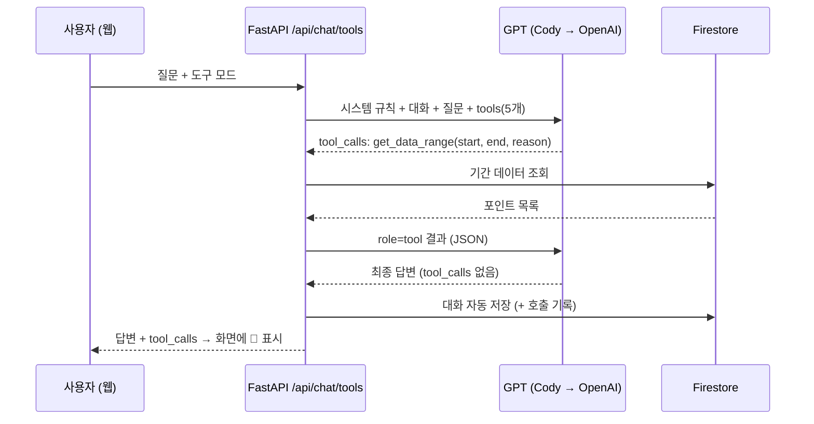
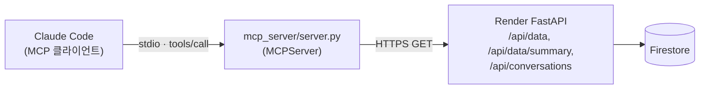

# My Stock AI 비서

> M1-2 미션 "내 데이터를 아는 AI 비서 만들기" 결과물

일반 챗봇은 내 데이터를 모릅니다. 이 서비스는 **삼성전자(005930.KS) 1년치 일별 종가(245개)** 를 Firestore에 저장하고,
그 요약(기간·개수·통계·추세·월별 통계·최근 값)을 **GPT 시스템 프롬프트에 주입**해서 "최근 추세가 어때?", "가장 높았던 때는?" 같은 질문에
실제 수치와 날짜로 답합니다. 데이터를 추가·수정·삭제하면 요약과 AI 답변에 바로 반영되고, 대화는 자동으로 저장돼 나중에 다시 불러올 수 있습니다.

## 배포 URL

| 구분 | URL |
| --- | --- |
| 프론트엔드 (Vercel) | https://ai-codyssey-frontend.vercel.app |
| 백엔드 API (Render) | https://mystock-ai-api.onrender.com |
| Swagger UI | https://mystock-ai-api.onrender.com/docs |

> Render 무료 티어는 15분간 요청이 없으면 잠듭니다. 첫 접속 시 프론트가 `/health` 를 호출하며
> "서버를 깨우는 중" 배너를 띄우고, 깨어날 때까지(최대 90초) 자동으로 재시도합니다.

## 기술 스택

| 영역 | 사용 기술 |
| --- | --- |
| 백엔드 | Python 3.13, FastAPI, Pydantic v2, Uvicorn |
| DB | Firebase Firestore (`firebase-admin`) |
| AI | 1순위 Codyssey OpenAI 호환 프록시(`gpt-5-mini`, httpx) → 실패 시 OpenAI 공식 API(`openai` SDK, `gpt-4o-mini`) |
| 프론트엔드 | HTML / CSS / JavaScript (프레임워크 없음), Chart.js |
| 배포 | Render (백엔드), Vercel (프론트엔드) |

## 폴더 구조

```
M1-2/
├── backend/
│   ├── main.py              # FastAPI 앱, CORS, 라우터 등록, /health
│   ├── core/config.py       # 환경 변수 로딩
│   ├── routers/             # HTTP 계층: data, conversations, chat
│   ├── services/            # 비즈니스 로직: repository(Firestore/메모리), summary, llm, chat, seed
│   │                        #   tools(도구 정의·실행), agent(도구 호출 루프) ← 보너스 5.1
│   ├── schemas/             # Pydantic 요청·응답 모델 (입력 검증)
│   ├── scripts/             # seed_data.py(수집·업로드), probe_tools.py(function calling 지원 확인)
│   ├── data/samsung_daily.csv
│   ├── tests/               # pytest 40개 (메모리 저장소 + 가짜 LLM)
│   ├── requirements.txt
│   └── .env.example
├── frontend/
│   ├── index.html, style.css, app.js
│   ├── config.js            # API 주소 (로컬 기본값)
│   ├── build-config.js      # Vercel 빌드 시 API_BASE_URL → config.js 생성
│   └── vercel.json
├── mcp_server/              # 보너스 5.1 MCP Server (stdio)
│   ├── server.py            # 읽기 전용 도구 5개 → REST API 호출
│   ├── check_client.py      # MCP 클라이언트로 도구 목록·호출 확인
│   ├── check_claude.py      # Claude Code(claude -p)로 실제 대화 확인
│   └── requirements.txt
├── .mcp.json                # Claude Code 프로젝트 범위 MCP 설정
└── docs/screenshots/        # 제출 스크린샷
```

**분리 기준**: `routers` 는 HTTP(경로·상태 코드·예외 → 응답)만, `services` 는 계산과 저장 로직만, `schemas` 는 데이터 형태와 검증만 맡습니다.
라우터는 `Repository` 인터페이스에만 의존하므로 Firestore ↔ 메모리 저장소를 설정 하나로 바꿀 수 있고, 테스트에서는 의존성을 교체해 키 없이 검증합니다.

## API

| 메서드 | 경로 | 설명 |
| --- | --- | --- |
| POST | `/api/data` | 데이터 추가 `{date, value, memo}` — 같은 날짜가 있으면 409 |
| GET | `/api/data` | 데이터 목록 (날짜 오름차순). 선택: `?start=YYYY-MM-DD&end=YYYY-MM-DD` 기간 필터 |
| PUT | `/api/data/{id}` | 데이터 수정 (보낸 필드만 변경) |
| DELETE | `/api/data/{id}` | 데이터 삭제 |
| GET | `/api/data/summary` | 요약: 기간, 개수, metrics(합계·평균·최고·최저·최신·변화율·변동성·이동평균), trend, monthly, recent |
| POST | `/api/conversations` | 대화 저장 `{title?, messages:[{role, content}]}` |
| GET | `/api/conversations` | 대화 목록 — **messages 미포함**(제목·메시지 수·시각만) |
| GET | `/api/conversations/{id}` | 특정 대화의 전체 messages (불러오기, 방식 A) |
| DELETE | `/api/conversations/{id}` | 대화 삭제 |
| POST | `/api/chat` | `{message, conversation_id?}` → 요약 조회 → 시스템 프롬프트 주입 → GPT 호출 → 자동 저장 |
| POST | `/api/chat/tools` | (보너스 5.1) 같은 입력 → GPT가 도구를 골라 데이터 조회 → 답변 + `tool_calls` 기록 → 자동 저장 |
| GET | `/health` | 헬스 체크 (콜드스타트 깨우기) |

### 입력 검증 (Pydantic)
- `date`: `YYYY-MM-DD` 형식의 실제 날짜, `value`: 0 이상 유한한 숫자(NaN·Infinity 거부), `memo`: 200자 이하
- 수정 요청은 최소 1개 필드 필요, 채팅 질문은 1~2000자, 메시지 `role` 은 `user`/`assistant` 만 허용
- 검증 실패는 422, 없는 ID는 404, 날짜 중복은 409, 키 미설정은 503, OpenAI 오류는 502로 응답합니다.

### LLM 호출 순서 (키 폴백)
1. `CODY_OPENAI_API_KEY` 가 있으면 Codyssey 프록시(`https://copa.codyssey.kr/v1/chat/completions`, `gpt-5-mini`)를 먼저 호출합니다.
2. 이 호출이 **401·403·429·5xx·타임아웃·빈 응답** 등으로 실패하면 `OPENAI_API_KEY` 로 OpenAI 공식 API(`gpt-4o-mini`)를 다시 호출합니다.
3. 둘 중 하나만 설정해도 동작하며, 둘 다 실패하면 502, 둘 다 없으면 503을 돌려줍니다.
4. `/api/chat` 응답의 `key_source`(`cody` | `openai`)로 어떤 키가 쓰였는지 알 수 있고, 채팅 화면 상단에도 "사용 키"로 표시됩니다.

### 컨텍스트 주입 원리
`/api/chat` 은 매 요청마다 `build_summary()` 로 **현재 저장된 데이터**의 요약을 다시 계산해 아래 형태의 시스템 프롬프트를 만듭니다.
GPT는 이 프롬프트를 "사실"로 받아 답하므로, 데이터를 바꾸면 다음 질문부터 답이 달라집니다. 이어지는 대화는 직전 메시지 10개를 함께 보냅니다.

```text
당신은 사용자의 시계열 데이터를 이해하고 있는 데이터 분석 비서입니다.

[사용자 데이터 요약] — 삼성전자(005930.KS) 일별 종가
- 데이터 기간: 2025-10-23 ~ 2026-10-23
- 총 레코드: 245개
- 주요 지표(원): 평균 …, 최고 …(날짜), 최저 …(날짜), 최신 …, 기간 변화율 …, 일간 변동성 …, 이동평균 …
- 최근 트렌드: 상승 (최근 20개 구간 +x.x%)

[월별 통계] (월 | 평균 | 최고 | 최저 | 월말값)
[최근 데이터] (날짜 | 값 | 메모)
답변 규칙 …
```

## 로컬 실행

Windows PowerShell 기준입니다.

```powershell
# 1) 가상환경 (M1-2 폴더에서)
python -m venv .venv
.\.venv\Scripts\Activate.ps1
pip install -r backend\requirements.txt

# 2) 환경 변수
cd backend
copy .env.example .env      # 값 채우기

# 3) Firestore에 시드 데이터 업로드 (최초 1회, 중복 날짜는 건너뜀)
python scripts\seed_data.py upload
#   (선택) 최신 데이터로 다시 수집: python scripts\seed_data.py fetch --range 1y

# 4) 백엔드 실행 → http://localhost:8000/docs
uvicorn main:app --reload

# 5) 프론트엔드 (새 터미널, M1-2\frontend 에서) → http://localhost:5500
python -m http.server 5500
```

- **Firebase 키 없이 화면만 확인**하려면 `.env` 에 `STORAGE_BACKEND=memory` 를 넣으세요. CSV 시드 데이터로 메모리에서 동작합니다(재시작 시 초기화).
- `CODY_OPENAI_API_KEY`, `OPENAI_API_KEY` 가 모두 없으면 채팅만 503으로 실패하고 나머지 기능은 동작합니다.
- 테스트: `backend` 폴더에서 `python -m pytest`

## 환경 변수

| 변수명 | 위치 | 설명 |
| --- | --- | --- |
| `CODY_OPENAI_API_KEY` | 백엔드 | Codyssey 프록시 키 — 1순위 (이것과 `OPENAI_API_KEY` 중 하나 이상 필수) |
| `OPENAI_API_KEY` | 백엔드 | OpenAI 공식 키 — Cody 호출 실패 시 폴백 |
| `CODY_MODEL` | 백엔드 | 프록시 모델명, 기본 `gpt-5-mini` |
| `FIREBASE_SERVICE_ACCOUNT_JSON` | 백엔드 | 서비스 계정 키 — JSON 문자열 또는 키 파일 경로 (필수) |
| `ALLOWED_ORIGINS` | 백엔드 | CORS 허용 도메인, 쉼표 구분 (배포 시 Vercel URL 포함) |
| `OPENAI_MODEL` | 백엔드 | 폴백 모델명, 기본 `gpt-4o-mini` |
| `OPENAI_MAX_TOKENS` | 백엔드 | 폴백 경로 응답 토큰 상한, 기본 600 (과금 방지) |
| `STORAGE_BACKEND` | 백엔드 | `firestore`(기본) 또는 `memory` |
| `API_BASE_URL` | 프론트(Vercel) | 백엔드 주소, 예 `https://mystock-ai-api.onrender.com` |

로컬에서는 `backend/.env` 값이 OS 환경 변수보다 우선합니다(시스템에 같은 이름의 변수가 있어도 `.env` 값 사용). Render에는 `.env` 가 없으므로 대시보드 환경 변수가 쓰입니다.

키와 서비스 계정 정보는 코드·git에 두지 않습니다. `.env` 와 키 파일(`*firebase-adminsdk*.json`)은 `.gitignore` 로 제외돼 있습니다.

## 배포

### 백엔드 — Render Web Service
1. GitHub에 푸시한 뒤 Render → **New → Web Service** → 저장소 연결
2. 설정
   - Root Directory: `M1-2/backend`
   - Build Command: `pip install -r requirements.txt`
   - Start Command: `uvicorn main:app --host 0.0.0.0 --port $PORT`
   - Instance Type: Free
3. Environment: `CODY_OPENAI_API_KEY`, `OPENAI_API_KEY`, `FIREBASE_SERVICE_ACCOUNT_JSON`, `STORAGE_BACKEND=firestore`, `ALLOWED_ORIGINS`(Vercel URL), `PYTHON_VERSION=3.13.5`
   - Firebase 키는 **Secret Files** 에 `firebase-key.json` 으로 올리고 `FIREBASE_SERVICE_ACCOUNT_JSON=/etc/secrets/firebase-key.json` 으로 지정하거나, 환경 변수 값에 키 JSON 내용 전체를 넣습니다.
   - (선택) Health Check Path: `/health`
4. 배포 후 https://mystock-ai-api.onrender.com/docs 에서 Swagger 확인

### 프론트엔드 — Vercel
1. Vercel → **Add New → Project** → 같은 저장소 선택
2. Root Directory: `M1-2/frontend` (Framework Preset: Other — 빌드 설정은 `vercel.json` 이 지정)
3. Environment Variables: `API_BASE_URL=https://mystock-ai-api.onrender.com`
4. 배포 후 Vercel URL을 Render의 `ALLOWED_ORIGINS` 에 추가하고 백엔드를 재배포
   (예: `https://ai-codyssey-frontend.vercel.app,http://localhost:5500` — 끝의 `/` 는 서버가 자동으로 제거)

정적 사이트는 런타임에 환경 변수를 읽을 수 없어서, 빌드 단계(`node build-config.js`)에서 `API_BASE_URL` 을 `config.js` 로 구워 넣습니다.

## 제출 스크린샷

배포 사이트(https://ai-codyssey-frontend.vercel.app)에서 촬영했습니다.

### 1. 데이터 요약이 보이는 채팅 화면 (질문 + 답변)
상단의 요약(기간·개수·트렌드·통계)과 그래프가 시스템 프롬프트에 주입되어, 답변이 실제 수치(최근 20개 구간 -20.8%, 최고 362,500원·2026-06-18)를 근거로 합니다.
채팅 상단에 사용한 키(`CODY_OPENAI_API_KEY`)와 반영된 요약이 표시됩니다.


### 2. 데이터 관리 화면 (수정 동작)
최신 행(2026-10-26)의 값과 메모를 수정해 저장한 직후입니다. 저장 결과 메시지와 함께 목록이 갱신되고 수정된 행이 강조됩니다.


### 3. 대화 기록 화면 (불러오기 동작)
왼쪽 목록에서 이전 대화 "최근 추세가 어때?"를 선택해, 저장된 메시지 4개를 다시 불러온 화면입니다.


## 보너스 5.1 — AI 도구 호출(Function Calling) + MCP Server

필수 과제의 `/api/chat` 은 서버가 요약을 **미리** 프롬프트에 넣습니다(컨텍스트 주입).
5.1에서는 GPT가 질문을 보고 **필요한 데이터만 도구로 직접 골라** 조회하게 하고, 같은 도구를 MCP Server로도 열어 외부 클라이언트(Claude Code)에서 호출하게 했습니다.

| | 컨텍스트 주입 (`/api/chat`) | 도구 호출 (`/api/chat/tools`, MCP) |
| --- | --- | --- |
| 데이터가 들어가는 시점 | 요청 전에 서버가 요약 전체를 넣음 | 모델이 필요할 때 도구로 조회 |
| 시스템 프롬프트 | 요약 + 월별 통계 + 최근 10개 | 데이터 없음 (도구 사용 규칙만) |
| 강점 | GPT 호출 1회로 단순하고 빠름 (측정 8~17초) | 특정 기간 원본·대화 기록처럼 요약에 없는 정보도 답함 |
| 약점 | 요약에 없는 세부(예: 3월 첫째 주 일별 값)는 답하기 어려움 | GPT 호출 2회 이상 (측정 10~21초), 토큰 사용 증가 |

### 도구 목록 (모두 읽기 전용)
백엔드(`services/tools.py`)와 MCP 서버(`mcp_server/server.py`)가 같은 5개를 제공합니다. 데이터를 바꾸는 도구는 두지 않았습니다. 모델이 잘못 판단해도 데이터가 바뀌지 않게 하기 위해서입니다.

| 도구 | 인자 | 하는 일 | 이 도구를 고르는 질문 |
| --- | --- | --- | --- |
| `get_data_summary` | — | 기간·개수·평균/최고/최저/최신·변화율·변동성·이동평균·트렌드 | "요즘 추세 어때?" |
| `get_data_range` | `start_date`, `end_date` | 기간 내 원본 포인트(최대 120개, 넘으면 `truncated`) | "3월 첫째 주 종가" |
| `get_monthly_stats` | `month?` (YYYY-MM) | 월별 평균·최고·최저·월말값 | "6월과 9월 비교" |
| `list_conversations` | — | 저장된 대화 목록(최근 20개) | "지난번에 뭘 물어봤지?" |
| `get_conversation` | `conversation_id` | 대화 하나의 메시지 | "그 대화에서 뭐라고 답했지?" |

### 어떤 근거로 어떤 도구를 호출하는가
1. **도구 설명(description)**: 각 도구가 무엇을 돌려주는지 스키마에 적어, 모델이 질문과 비교해 고르게 합니다.
2. **시스템 프롬프트 규칙**: 다음 세 가지 규칙을 둡니다.
   - 데이터 질문은 추측하지 말고 도구 결과에 근거한다.
   - 기간이 정해진 질문은 `get_data_range` 로 그 기간만 조회한다.
   - "마지막 주"처럼 모호한 범위는 되묻지 말고 합리적으로 해석해 조회한 뒤, 해석한 기간을 밝힌다.
3. **`reason` 인자 (필수)**: 백엔드 도구 모드의 모든 도구는 `reason`(호출 이유 한 문장)을 필수로 받습니다. 실행에는 쓰지 않지만 호출 기록에 남겨, **모델이 스스로 밝힌 근거**를 화면과 응답에서 볼 수 있습니다.
4. **호출 기록 `tool_calls`**: `/api/chat/tools` 응답과 저장된 대화(assistant 메시지)에 `{round, name, arguments, reason, ok, result_summary}` 를 남기고, 채팅 화면 답변 아래에 표시합니다.

실제 호출 예시 (Cody `gpt-5-mini`, 2026-10-26):

| 질문 | 모델이 고른 도구 (인자) | 모델이 밝힌 근거 (`reason`) | 답변 요지 |
| --- | --- | --- | --- |
| 2026년 3월 첫째 주(3/2~3/6) 종가를 알려줘 | `get_data_range(2026-03-02, 2026-03-06)` | 해당 기간의 일별 종가를 정확히 조회하기 위해 이 기간의 원본 데이터를 불러옴 | 3/3~3/6 4일치 종가·메모. 3/2는 데이터 없음을 짚음 |
| 6월과 9월의 월평균을 비교해 줘 | `get_monthly_stats()` | 6월과 9월의 월평균을 확인하기 위해 월별 통계 조회 | 334,929원 대 263,300원, 6월이 약 27% 높음 |
| 2026년 9월 마지막 주 종가 흐름을 알려줘 | `get_data_range(2026-09-01, 2026-09-30)` | 9월 전체 거래일을 조회해 마지막 거래일을 확인하고, 그날이 속한 주의 흐름을 보기 위해 | "9/28~9/30로 해석"이라고 밝힌 뒤 일별 종가·주간 변동 |
| 저장된 대화에서 내가 한 질문들을 정리해 줘 | `list_conversations()` | 저장된 대화 목록을 먼저 확인해야 함 | 대화 제목·메시지 수 정리 |

### 호출 흐름


- 도구 호출 → 결과 전달은 **최대 4회** 반복합니다. 넘으면 `tool_choice="none"` 으로 지금까지의 결과로 답하게 합니다.
- 잘못된 인자(날짜 형식, 없는 대화 ID, 없는 도구)는 서버가 실행하지 않고 오류 내용을 `role=tool` 로 돌려줘, 모델이 스스로 고쳐 다시 부르게 합니다.
- Cody 호출이 도중에 실패하면 OpenAI로 **처음부터** 다시 합니다. 공급자마다 tool_call id 체계가 달라 중간부터 이어 붙이지 않습니다.
- Codyssey 프록시가 function calling(`tools`, `tool_calls`, `role: tool`)을 지원하는지는 `backend/scripts/probe_tools.py` 로 확인했습니다. 두 단계 모두 HTTP 200이었습니다.

### 웹에서 사용
채팅 입력창 위의 **🔧 도구 호출 모드** 를 켜면 `/api/chat/tools` 로 보냅니다(설정은 브라우저에 기억).
답변 아래에 `1. get_data_range(start_date=…, end_date=…) → …개`, `근거: …` 가 표시되고, 대화를 다시 불러와도 남아 있습니다.

### MCP Server (외부 채널: Claude Code)
`mcp_server/server.py` 는 MCP Python SDK(2.x `MCPServer`, stdio)로 같은 도구 5개를 제공합니다.
도구는 배포된 REST API(`MYSTOCK_API_BASE_URL`, 기본 `https://mystock-ai-api.onrender.com`)를 호출하므로 **MCP 서버에는 Firebase·OpenAI 키가 필요 없습니다.**
모든 도구에 `read_only_hint` 를 붙였고, API 오류는 MCP `ToolError` 로 바꿔 클라이언트의 모델이 이유를 읽을 수 있게 했습니다.



**설치·확인** (M1-2 폴더, venv 활성화 상태)
```powershell
pip install -r mcp_server\requirements.txt
python mcp_server\check_client.py                         # 도구 목록·호출 확인 (배포 API)
python mcp_server\check_client.py http://localhost:8000   # 로컬 API 대상
```

**Claude Code에 등록** (둘 중 하나)
- 프로젝트 설정 파일: 포함된 [`.mcp.json`](.mcp.json)을 씁니다. M1-2 폴더에서 Claude Code를 열면 이 서버를 쓸지 묻고, 승인하면 연결됩니다. Windows `.venv` 경로 기준이며, macOS/Linux는 `command` 를 `.venv/bin/python` 으로 바꿉니다.
- 명령: `claude mcp add my-stock-ai -e MYSTOCK_API_BASE_URL=https://mystock-ai-api.onrender.com -- .venv/Scripts/python.exe mcp_server/server.py` → `claude mcp list` 로 확인

**실제 대화 확인** — `python mcp_server/check_claude.py "질문"` 은 `claude -p` 를 이 프로젝트의 MCP 설정만 붙여(`--strict-mcp-config`) 실행하고, Claude가 고른 도구와 답을 출력합니다. 2026-10-26에 확인한 결과입니다.

| 질문 | Claude가 호출한 MCP 도구 | 결과 |
| --- | --- | --- |
| 2026년 6월과 9월 월평균을 비교하고, 3월 첫째 주 종가도 알려줘 | `get_monthly_stats(2026-06)`, `get_monthly_stats(2026-09)`, `get_data_range(2026-03-01~03-08)` | 6월 334,929원 대 9월 263,300원(−21.4%) 표 비교 + 3월 첫째 주 종가 표 (21초) |
| 저장된 대화 중 '최근 추세가 어때?' 대화에서 AI가 어떻게 답했는지 3줄로 요약해줘 | `list_conversations()` → `get_conversation(A3y43Bzz…)` | 그 대화의 하락 추세·이동평균·급락 날짜·1년 최고/최저를 3줄 요약 (19초) |

## 보너스 5.2 — 인사이트·UX 고도화
- 추가 지표: 일간 변동성(일간 변화율 표준편차), 5·20일 이동평균, 기간 변화율, 월별 통계
- 시각화: Chart.js 추이 그래프 + 20일 이동평균선
- 내보내기: CSV(엑셀 한글 호환 BOM 포함) / JSON(요약 포함) 다운로드
- 다크 모드 토글 (설정 기억, 시스템 테마 기본값)

## 설계 메모

### Firestore 컬렉션 구조
| 컬렉션 | 문서 필드 | 비고 |
| --- | --- | --- |
| `data` | `date`(YYYY-MM-DD 문자열), `value`, `memo`, `created_at`, `updated_at` | `date` 로 정렬·중복 검사. 문자열 날짜는 사전순 = 시간순이라 별도 인덱스 없이 정렬됩니다. |
| `conversations` | `title`, `messages[{role, content}]`, `message_count`, `created_at`, `updated_at` | 목록 조회는 `select()` 로 `messages` 를 빼고 읽어 전송량을 줄입니다. |

서버는 Firebase Admin SDK(서비스 계정)로 접근하므로 브라우저는 Firestore에 직접 접근하지 않습니다. 데이터베이스는 프로덕션 모드(클라이언트 접근 차단)로 두면 됩니다.

### 배포 환경에서 CORS·환경 변수·키 관리가 필요한 이유
- **CORS**: 프론트(`vercel.app`)와 백엔드(`onrender.com`)의 출처가 달라, 브라우저는 서버가 허용한 출처의 요청만 응답을 읽게 합니다. `ALLOWED_ORIGINS` 로 우리 프론트만 허용하고 나머지 출처는 거부합니다.
- **환경 변수**: 로컬·Render·Vercel마다 값(API 주소, 허용 도메인, 저장소 종류)이 달라서, 코드는 그대로 두고 설정만 바꿔 배포할 수 있게 합니다.
- **키 관리**: OpenAI·Codyssey 키와 Firebase 서비스 계정 키가 코드나 git에 들어가면 누구나 과금을 일으키거나 DB 전체에 접근할 수 있습니다. 그래서 키는 서버 환경 변수(Secret File)에만 두고, 브라우저에는 백엔드 주소만 전달합니다.

## 비용 주의
- 질문 1회당 시스템 프롬프트(요약 + 월별 통계 + 최근 10개)와 직전 대화 10개가 함께 전송됩니다.
- `OPENAI_MAX_TOKENS` 로 폴백(OpenAI) 경로의 응답 길이를 제한합니다. Cody 프록시(`gpt-5-mini`)는 추론 토큰이 출력 상한에 포함돼 빈 답이 나올 수 있어 상한을 보내지 않습니다.
- OpenAI 대시보드에서 사용 한도(Usage limit)를 설정해 두세요.
